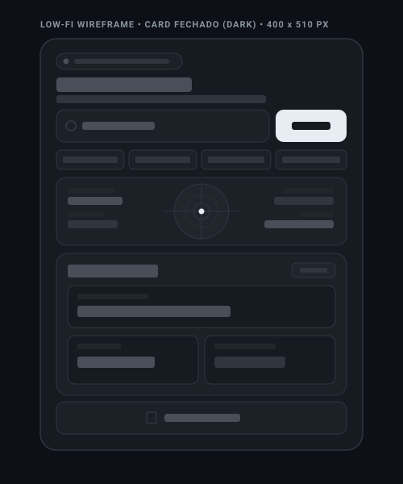
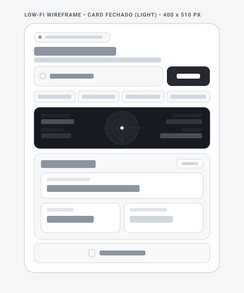
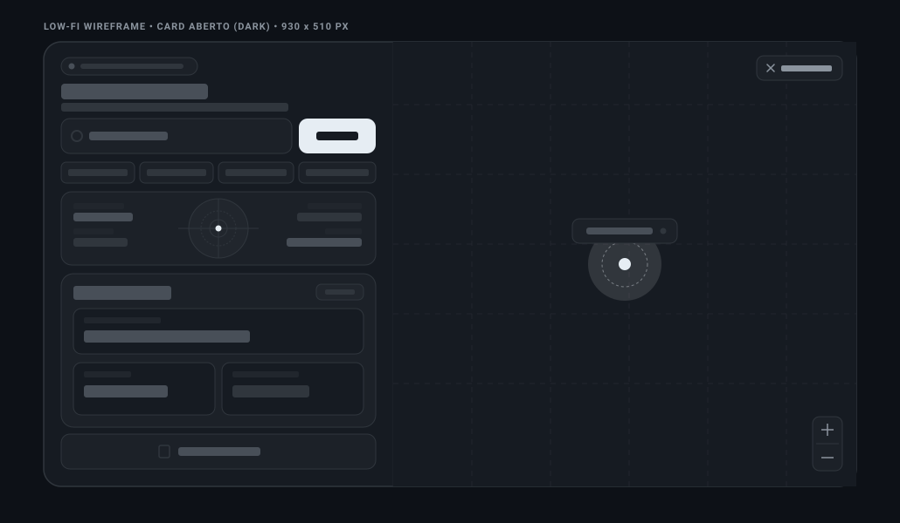
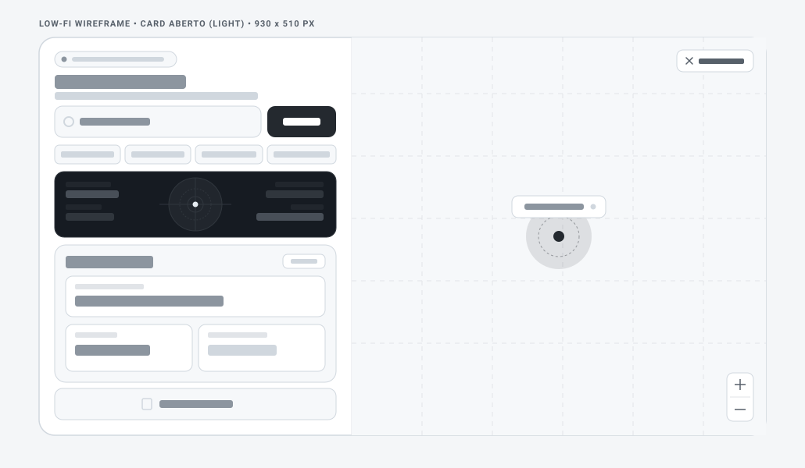
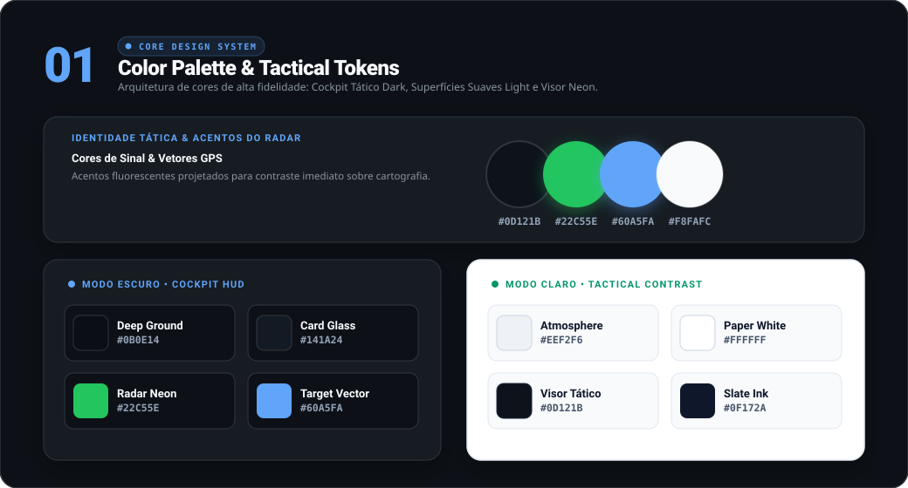
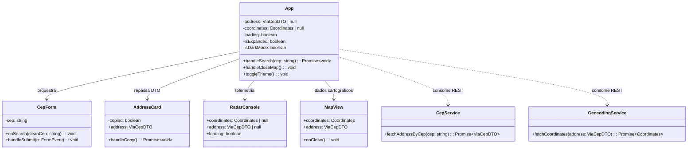

# 🗺️ Radar CEP & Geolocalização Vetorial 

<p align="left">
  
  
  
  
  
  
  
</p>

---

## ⚡ Experimente a Aplicação ao Vivo!

> ### 🛰️ Quer testar a triangulação e o radar em tempo real?
> Você não precisa instalar nada no seu computador para ver a engenharia funcionando. Acesse a versão de produção hospedada na CDN global:
>
> <p align="left">
>   <a href="https://applephoria.github.io/CEPLookup-Geolocalizacao/" target="_blank">
>     
>   </a>
> </p>
>
> 🚀 *Aplicação compilada e distribuída com CI/CD automatizado via GitHub Actions a cada commit na branch `main`.*

<details>
<summary><b>⚙️ Como funciona o Deploy Contínuo (CI/CD) no GitHub Pages? (Clique para expandir)</b></summary>
<br>

O projeto conta com uma esteira de automação industrial configurada em [`.github/workflows/deploy.yml`](./.github/workflows/deploy.yml):
1. **Trigger Automático:** A cada `git push` na branch `main`, a GitHub Action acorda uma máquina virtual Ubuntu.
2. **Build Hermético:** Instala as dependências (`npm ci`), compila os contratos TypeScript e empacota os assets vetoriais com Vite (`npm run build`).
3. **Zero Downtime Deploy:** Publica o diretório `dist` diretamente na CDN global do GitHub Pages.

> **Para ativar no seu repositório:** Acesse `Settings ➔ Pages` no seu GitHub e, em *Build and deployment / Source*, selecione **GitHub Actions**.
</details>

---

## 📌 Sobre o Projeto & Minha Jornada de Engenharia

> 👋 Olá! Este é o meu **primeiro projeto consumindo APIs REST no ecossistema Web moderno** com **React 19** e **TypeScript estrito**.
>
> Vindo dos meus estudos profundos de arquitetura de software e sistemas em C# e C, meu objetivo aqui foi **ir muito além de um simples formulário visual**. Construí uma aplicação tática de alta performance para busca e triangulação geográfica de endereços brasileiros, tratando o fluxo de dados com rigor de engenharia: contratos tipados (DTOs), ciclo de vida determinístico, testes unitários automatizados com mocks e separação estrita de camadas.

---

## 🧠 Decisões Arquiteturais & Trade-offs de Engenharia

Como arquiteto de software, cada tecnologia adotada neste projeto foi respaldada por uma análise crítica de vantagens e desvantagens:

### 1. Por que OpenStreetMap + Nominatim e NÃO Google Maps Platform?
* **Zero Vendor Lock-in & Soberania de Dados:** O Google Maps exige cadastro compulsório de cartão de crédito e faturamento em dólares por requisição (*pay-as-you-go*), trazendo risco financeiro para projetos públicos e protótipos de alta escala.
* **Open Source & Descentralização:** O **OpenStreetMap (OSM)** e o motor de busca **Nominatim** são iniciativas abertas mantidas pela comunidade global, oferecendo endpoints REST abertos sem necessidade de tokens proprietários intrusivos.
* **Leveza de Rede:** Em vez de carregar os pesados bundles JavaScript proprietários do Google (que pesam centenas de kilobytes e injetam múltiplos scripts rastreadores), consumimos dados limpos via JSON nativo.

### 2. Por que Leaflet com Mapbox Tiles?
* **Arquitetura Plugável e Performática:** O **Leaflet** possui apenas ~42KB gzipped, renderizando camadas vetoriais e tiles cartográficos diretamente no canvas/DOM com aceleração por hardware GPU.
* **Total Liberdade de Customização CSS:** Permitiu criar marcadores cartográficos exclusivos com animação de pulso verde neon (*radar beacon*) e o visual de HUD tático monocromático, sem as restrições de estilo impostas por SDKs proprietários fechados.

---

## 📐 Kit de Wireframes Low-Fi (Figma Architecture)

A concepção da interface seguiu a metodologia **Visual-First ("Começar pelo Volante")**, desenhando primeiro a estrutura de caixas, divs e proporções espaciais antes da fiação lógica.

Os wireframes vetoriais em escala 1:1 monocromática encontram-se versionados na pasta [`figma/`](./figma):

| Modo Escuro (Dark Mode) | Modo Claro (Light Mode) |
| :---: | :---: |
| **Card Fechado (`400 x 510 px`)**<br><br> | **Card Fechado (`400 x 510 px`)**<br><br> |
| **Card Aberto com Mapa (`930 x 510 px`)**<br><br> | **Card Aberto com Mapa (`930 x 510 px`)**<br><br> |

---

## 🎨 Design Tokens & Paleta Cromática (Dribbble Showcase)

Inspirado nas referências visuais de **Design Systems do Dribbble** (como o *Core Design System* de Ryan Sael e o *Colors.cafe*), a identidade gráfica harmoniza uma estética tática com legibilidade estrita:

<p align="center">
  
</p>

### 🔬 Anatomia dos Tokens

| Token CSS | Amostra | HEX | Papel na Arquitetura |
| :--- | :---: | :---: | :--- |
| `--accent-radar` | 🟢 | `#22C55E` | Feixe de varredura ativa do radar e marcadores neon no mapa |
| `--accent-gps` | 🔵 | `#60A5FA` | Vetores de satélite e coordenadas geográficas de precisão |
| `--radar-visor-dark` | ⬛ | `#0D121B` | Superfície tática de alto contraste (preservada no Dark e no Light) |
| `--surface-dark` | ⬛ | `#141A24` | Vidro translúcido escuro do card com borda sutil `rgba(255,255,255,0.08)` |
| `--surface-light` | ⬜ | `#FFFFFF` | Superfície pura do card no modo diurno com borda `rgba(15,23,42,0.08)` |
| `--text-main` | 🔲 | `#F8FAFC` / `#0F172A` | Tipografia de alto contraste para leitura rápida de endereços |

---

## 📑 Hub de Documentação Técnica e Modelagem UML

Este repositório possui documentação técnica dedicada e aprofundada para consulta de engenharia:

| Seção de Documentação | Conteúdo Detalhado | Link de Acesso |
| :--- | :--- | :---: |
| **Modelagem UML Completa** | Máquina de Estados, Casos de Uso, Arquitetura de Componentes e Resiliência Fail-Fast. | [📐 Ver Diagramas UML](./docs/uml/README.md) |
| **Estudo de Caso & Aprendizados** | Transição de C/C# para React, Rastro dos Dados na RAM e Física do Tempo. | [📖 Acessar Estudo de Caso](./docs/APRENDIZADOS_E_ARQUITETURA.md) |
| **Kit de Wireframes Figma** | Especificações vetoriais de divs e caixas em baixa fidelidade para montagem no Figma. | [🧱 Acessar Kit Figma](./figma/COMO_USAR_NO_FIGMA.md) |

---

## 🏛️ Modelagem e Diagramas de Arquitetura (UML)

### 1. Diagrama de Sequência: O Rastro dos Dados nas APIs REST
Mapeamento de ida e volta desde a digitação física no teclado até a aterrissagem dos dados na tela e renderização do mapa:

```mermaid
sequenceDiagram
    autonumber
    actor User as Usuário (Teclado/Mouse)
    participant UI as CepForm (View)
    participant App as App.tsx (State Orchestrator)
    participant ViaCEP as ViaCEP (REST API)
    participant Nominatim as Nominatim OSM (Geocoding API)
    participant Radar as RadarConsole (HUD)
    participant Map as MapView (Leaflet Map)

    User->>UI: Digita CEP e pressiona [Enter]
    UI->>UI: Valida formato (8 dígitos numéricos)
    UI->>App: Dispara onSearch(cleanCep)
    App->>App: Define isLoading = true
    
    rect rgb(20, 26, 36)
        Note over App,ViaCEP: 1ª Fronteira de Rede: Resolução de Endereço
        App->>ViaCEP: GET https://viacep.com.br/ws/{cep}/json/
        ViaCEP-->>App: Retorna ViaCepDTO (logradouro, bairro, localidade, uf)
    end

    rect rgb(20, 26, 36)
        Note over App,Nominatim: 2ª Fronteira de Rede: Triangulação Cartográfica
        App->>Nominatim: GET /search?format=json&q={logradouro, localidade, uf}
        Nominatim-->>App: Retorna [ { lat: "-23.56", lon: "-46.65" } ]
    end

    App->>App: Atualiza State (address, coordinates, isExpanded=true)
    App->>Radar: Renderiza Telemetria e Coordenadas GPS
    App->>Map: Projeta Marcador Neon e Voa a Câmera (flyTo)
    App->>UI: Exibe Card de Endereço Formatado
```



### 2. Diagrama de Estrutura de Componentes & Camadas
Arquitetura em camadas estritas com separação entre Visão, Estilos, Estado e Serviços:



---

## 📂 Estrutura Modular do Projeto

Organização limpa com separação estrita de responsabilidades: componentes lógicos isolados de suas folhas de estilo:

```text
CEPLookup-Geolocalizacao/
├── figma/                     # Wireframes Low-Fi 1:1 e guia de uso
│   ├── wireframe-card-fechado-dark.svg
│   ├── wireframe-card-aberto-dark.svg
│   ├── wireframe-card-fechado-light.svg
│   ├── wireframe-card-aberto-light.svg
│   └── COMO_USAR_NO_FIGMA.md
├── docs/                      # Estudo de Caso, Decisões de Arquitetura e Modelagem UML
│   └── APRENDIZADOS_E_ARQUITETURA.md
└── code/                      # Código Fonte da Aplicação
    ├── src/
    │   ├── components/        # Componentes Funcionais Puros (.tsx)
    │   │   ├── AddressCard.tsx
    │   │   ├── CepForm.tsx
    │   │   ├── MapView.tsx
    │   │   └── RadarConsole.tsx
    │   ├── styles/            # Folhas de Estilo e Variáveis CSS (.css)
    │   │   ├── AddressCard.css
    │   │   ├── App.css
    │   │   ├── CepForm.css
    │   │   ├── index.css
    │   │   ├── MapView.css
    │   │   └── RadarConsole.css
    │   ├── services/          # Camada de Comunicação com APIs REST
    │   │   ├── cepService.ts
    │   │   ├── geocodingService.ts
    │   │   └── cepService.test.ts  # Testes Unitários Automatizados
    │   ├── types/             # Contratos de Dados e DTOs TypeScript
    │   │   └── address.ts
    │   ├── App.tsx            # Orquestrador Central de Estado
    │   └── main.tsx           # Entrypoint da Aplicação
    ├── package.json
    ├── vite.config.ts
    └── tsconfig.json
```

---

## 🧪 Qualidade de Código & Testes Unitários

O projeto conta com suite de testes automatizados utilizando **Vitest**, validando requisições, tratamento de erros (*Fail-Fast*) e contratos de retorno de APIs externas com mocks determinísticos:

```bash
# Execução dos testes unitários
cd code
npm test -- --run
```

Resultado verificado:
```text
 ✓ src/services/cepService.test.ts (3 tests)
   ✓ cepService
     ✓ deve retornar o endereço correto para um CEP válido
   ✓ geocodingService
     ✓ deve retornar as coordenadas corretas para um endereço válido

 Test Files  1 passed (1)
      Tests  3 passed (3)
```

---

## 🚀 Como Executar o Projeto Localmente

### Pré-requisitos
* **Node.js** (versão 18 ou superior)
* Gerenciador de pacotes **npm** ou **yarn**

### Passo a Passo

1. **Clone o repositório:**
   ```bash
   git clone https://github.com/applephoria/CEPLookup-Geolocalizacao.git
   cd CEPLookup-Geolocalizacao/code
   ```

2. **Instale as dependências:**
   ```bash
   npm install
   ```

3. **Configure as variáveis de ambiente (Opcional):**
   ```bash
   cp .env.example .env
   ```
   > *Nota:* A aplicação possui fallback automático para tiles livres do OpenStreetMap sem necessidade obrigatória de chaves de API.

4. **Inicie o servidor de desenvolvimento:**
   ```bash
   npm run dev
   ```
   Abra no seu navegador: `http://localhost:5173`

5. **Build de produção e verificação TypeScript:**
   ```bash
   npm run build
   ```

---

#  Used languages and tools:

<p align="left">
  
  
  
  
  
  
  
  
  
</p>

---

# 🙋‍♂️ Connect with me 

<table>
  <tr>
    <a target="_blank" href="https://beacons.ai/applephoria/aboutme"></a>
    <a href="https://www.linkedin.com/in/marcelflorentino/"></a>
    <a href="https://www.instagram.com/applephoria/" target="_blank"></a>
    <a href="mailto:eumarcelflorentino@gmail.com"></a>
  </tr> 
</table>
