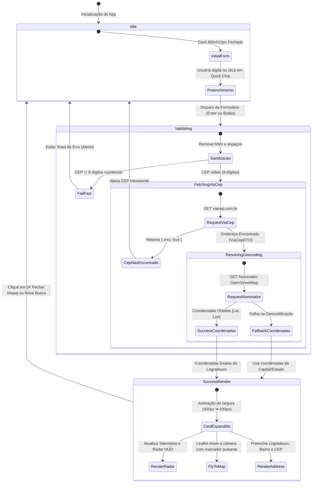
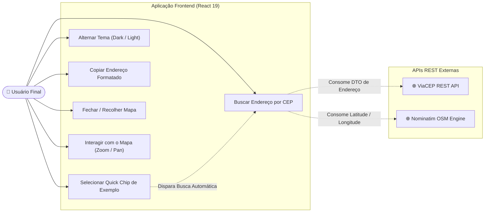
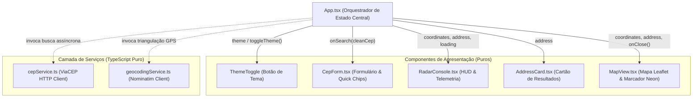
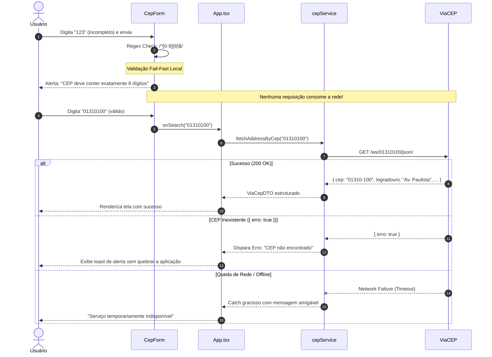

# 📐 Modelagem Arquitetural & Diagramas UML

Este documento reúne a especificação visual e formal da arquitetura do **CEP Lookup & Geolocalização**, mapeando o comportamento de estado, casos de uso e ciclo de vida antes da implementação em código.

---

## 🧭 Índice dos Diagramas

1. [Máquina de Estados: Ciclo de Vida da Aplicação](#1-máquina-de-estados-ciclo-de-vida-da-aplicação)
2. [Diagrama de Casos de Uso (Use Cases)](#2-diagrama-de-casos-de-uso-use-cases)
3. [Diagrama de Arquitetura de Componentes e Fluxo de Props](#3-diagrama-de-arquitetura-de-componentes-e-fluxo-de-props)
4. [Diagrama de Sequência de Resiliência & Fail-Fast](#4-diagrama-de-sequência-de-resiliência--fail-fast)

---

## 1. Máquina de Estados: Ciclo de Vida da Aplicação

Mapeia as transições determinísticas de estado dentro do orquestrador central (`App.tsx`):

---

## 2. Diagrama de Casos de Uso (Use Cases)

Mapeia as fronteiras entre o usuário físico, a aplicação frontend e as APIs externas de nuvem:

---

## 3. Diagrama de Arquitetura de Componentes e Fluxo de Props

Demonstra o princípio da **Single Source of Truth (Fonte Única da Verdade)** onde o componente `App.tsx` retém o estado mestre e distribui dados para componentes filhos puros:

---

## 4. Diagrama de Sequência de Resiliência & Fail-Fast

Mapeia a inteligência defensiva que previne requisições de rede desnecessárias e trata erros graciosamente:

